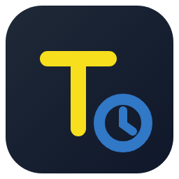

<p align="center"></p>

# Tracelight

A JavaScript and TypeScript playground in VS Code. Tracelight runs the file you are editing on
Node and shows what happened right in the editor: values next to the lines that produced them,
coverage in the gutter, and a Time Machine that records the run so you can step forwards and
backwards through it. It also has a plain debugger, a browser page, a command-line tool and an
MCP server, so agents can read a run the same way you do.

## Features

- **Live values.** `console.log` output and the value of a bare expression appear after their
  line. A `// ?` comment shows an expression's value without changing the code; logpoints (F9)
  do the same from the gutter. Hover an expression to evaluate it.
- **Coverage.** The gutter marks lines that ran, partly ran, never ran, and the path an error
  took.
- **Time Machine.** Every statement of a run is recorded. Step into, over and out, forwards and
  backwards, run to a line or a breakpoint, and watch expressions at any step. Variable History
  and "Why This Value" trace where a value came from.
- **Code Story and Execution Diagram.** The run as one read-only document, one block per pass
  through a function, and as a graph of calls, decisions and errors.
- **Debugger.** Launch type `tracelight`: breakpoints, stepping, the call stack, variables and a
  REPL on a live program, with or without recording.
- **HTTP.** The requests a run made, and record/replay of `http`/`https`, `fetch` and XHR traffic
  so re-runs of API-driven code are free and repeatable.
- **Profile and Snaps.** A CPU profile of one run; `/*{{ ... }}*/` snippets that run in place.
- **Secrets masked.** Values of secret environment variables and anything under a secret-looking
  name show as `••••••••`.
- **Agents.** The `tracelight` CLI, `tracelight mcp` and an agent skill read runs and drive the
  debugger.

## Requirements

- VS Code 1.93 or newer.
- Node.js **22.18 or newer** (Node 24 recommended) on `PATH`, or set `tracelight.nodePath`.
  Tracelight runs TypeScript with Node's built-in type stripping; there is nothing else to
  install.

## Install

From a release: download the `.vsix` for your platform from
[GitHub releases](https://github.com/ivorpad/tracelight/releases) and install it with
**Extensions: Install from VSIX...** or `code --install-extension tracelight-0.1.0.vsix`.

From source: see [Development](#development), then `npx vsce package` and install the `.vsix` it
writes. The package includes oxc-parser's native binary, so build it on the platform you will
run it on.

## Quick start

1. Open a `.js`, `.mjs`, `.cjs`, `.ts`, `.mts`, `.cts`, `.jsx` or `.tsx` file.
2. Run **Tracelight: Start on Current File** (`Ctrl+K Q`, `Cmd+K Q` on macOS). Values appear as
   the file runs; by default it re-runs on save (`tracelight.runMode`).
3. Press `Shift+F5` in a running file to start the Time Machine at the current line, then step
   with `F10` / `F11` / `Shift+F11` (back: `Ctrl+F10` / `Ctrl+F11` / `Ctrl+Shift+F11`).
   `Shift+F5` again stops it.

To debug a live program, press F5 with a `tracelight` launch configuration, or run
**Tracelight: Debug Current File**:

```jsonc
// .vscode/launch.json
{
  "version": "0.2.0",
  "configurations": [
    { "type": "tracelight", "request": "launch", "name": "Tracelight: Debug Current File", "program": "${file}" },
    { "type": "tracelight", "request": "launch", "name": "Tracelight: Debug Current File (Recording)", "program": "${file}", "record": true }
  ]
}
```

Launch attributes: `program`, `args`, `cwd`, `env`, `stopOnEntry`, `breakOnException`,
`libraryCode`, `record`, `node`. With `record: true` the debug session also records, so the Time
Machine can go back.

## Commands

All commands are under **Tracelight:** in the Command Palette. The ones you will use most:

| Command | |
|---|---|
| Start on Current File / Toggle / Stop Current / Stop All | start and stop a session |
| Run on save / Run automatically / Run on demand / Re-execute file | when the file runs |
| New JavaScript File / New TypeScript File / New File | a scratch file that starts running |
| Show Value / Show Line Value(s) / Copy Value / Clear File Values | values in the editor |
| Toggle Auto Log | show a value for every line |
| Start Time Machine On The Current Line | record and step through the run |
| View Code Story / Show Execution Diagram / Show Variable History / Why This Value | read a run |
| Debug Current File / Debug Current File (Recording) | the live debugger |
| Show HTTP Requests / Open HTTP Recording | the run's HTTP traffic |
| Profile | a CPU profile of one run |
| Show Tour / Narrate Walkthrough / Narrate Tour | a guided tour of a run, optionally narrated by a model command |
| Select Node.js for Tracelight | pick the Node binary |
| Show Output / Show Logs | the panel and Tracelight's own log |

## Settings

| Setting | Default | |
|---|---|---|
| `tracelight.nodePath` | `""` | Node executable; empty means `node` on PATH |
| `tracelight.runMode` | `onSave` | default run mode for new sessions (`onSave`, `onDemand`, `auto`, `smart`) |
| `tracelight.autoLog` | `false` | start sessions with a value for every line |
| `tracelight.runTimeout` | `30000` | kill a run after this many ms (0 = never) |
| `tracelight.env`, `tracelight.args` | `{}`, `[]` | environment and `process.argv.slice(2)` for the run |
| `tracelight.maxTraceSteps` | `999999` | recorded Time Machine steps per run |
| `tracelight.timeMachine.libraryCode` | `false` | record and step into code in `node_modules` |
| `tracelight.timeMachine.recordLocals` | `false` | record every changed local at every step |
| `tracelight.timeMachine.exclude` | `[]` | packages or path globs left out of the recording |
| `tracelight.http` | `off` | `record` or `replay` the run's HTTP traffic |
| `tracelight.secrets.mask` | `true` | mask secrets in every value shown |
| `tracelight.agentAccess` | `false` | let local agents read runs and drive the Time Machine; installs the `tracelight` CLI |
| `tracelight.explain.command` | `""` | command that narrates walkthroughs and tours (empty: `claude`, else `codex`, else Copilot's model) |

Settings → Extensions → Tracelight lists the rest.

## Command line and MCP

With `tracelight.agentAccess` on, the extension writes a `tracelight` script to `~/.local/bin`
(macOS and Linux) that runs the extension's own runtime, and offers to put that directory on your
PATH. It is rewritten on every activation, so it never goes stale.

```sh
tracelight run app.ts --save run.json        # run and record
tracelight story run.json --file app.ts       # the run as a map, one step number per line
tracelight step run.json 42 --into            # land in a callee with its arguments
tracelight why run.json 42 total              # where a value came from
tracelight debug app.ts --at handleRequest    # start the live debugger and stop there
tracelight story --live                       # read the run open in VS Code
```

`tracelight` with no arguments lists every command. `tracelight mcp` serves the same commands to
any MCP client over stdio:

```sh
claude mcp add tracelight -- tracelight mcp
codex mcp add tracelight -- tracelight mcp
```

From a checkout, `node node/bin/tracelight.mjs` is the same CLI.

## In a browser

The panel, a code pane and the Time Machine also run in a browser tab, outside VS Code:

```sh
node dist/web/server.js path/to/file.ts --open    # http://127.0.0.1:4777/
```

An agent can drive the open page and explain as it steps
(`node dist/web/server.js ctl step over --say "..."`). See [docs/WEB.md](docs/WEB.md).

## Agent skill

[`skills/tracelight/`](skills/tracelight/SKILL.md) teaches a coding agent (Claude Code, Codex) to
use Tracelight in three modes: `debug` (pause a running program and step it), `explain` (walk a
person through a run in their editor) and `show` (hand over a tour or a code-history page whose
every value comes from the run). Copy or link the directory into your agent's skills folder.

## Development

```sh
npm ci && npm ci --prefix node      # the extension's and the runtime's dependencies
node esbuild.mjs                    # build into dist/ (the runtime is copied to dist/node); --watch to rebuild
npm test                            # typecheck, vitest unit tests, the runtime's node:test suite
npm run test:e2e                    # end to end in a downloaded VS Code (@vscode/test-cli, .vscode-test.mjs)
npx vsce package                    # tracelight-<version>.vsix for this platform
```

Where VS Code cannot be downloaded (a container), run the e2e specs in code-server with a
packaged vsix:

```sh
test/code-server/run.sh WORKSPACE test/e2e/tracelight.test.js ivor.tracelight tracelight.vsix
```

Layout: `src/` the extension, `webview/` the panel, `web/` the browser page, `node/` the runtime,
CLI and MCP server, `skills/tracelight/` the agent skill. Design notes:
[docs/RUNTIME.md](docs/RUNTIME.md) (the runtime), [docs/PROTOCOL.md](docs/PROTOCOL.md) (the wire
contract between them), [docs/WEB.md](docs/WEB.md) (the browser page).

## License

[MIT](LICENSE)
